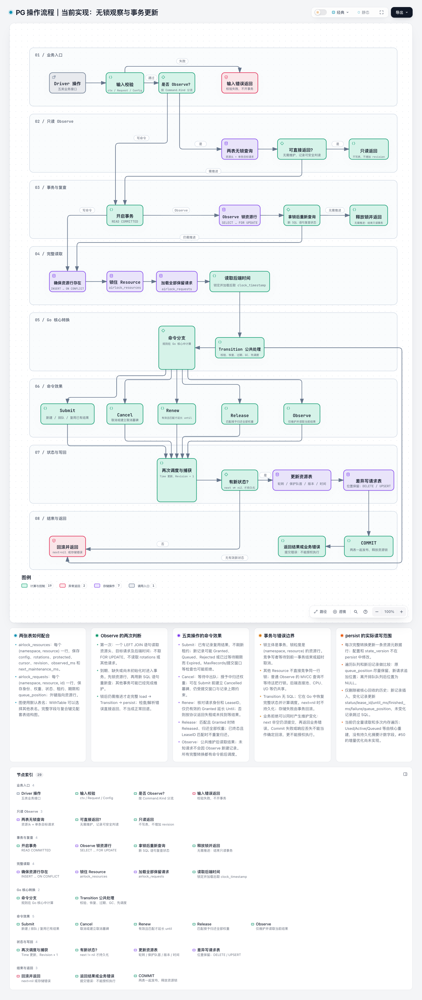
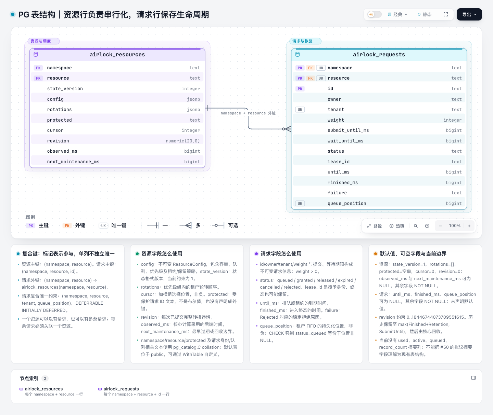
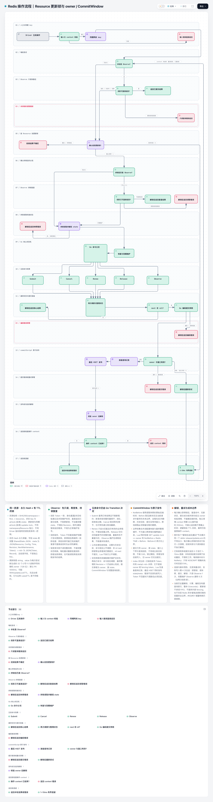

# Airlock architecture atlas

[English](README.md) | [简体中文](README.zh-CN.md) | [Open the atlas](index.html)

These diagrams explain implemented behavior and route readers to runnable examples,
source contracts and regression tests. Diagram prose is Chinese with unchanged API
names; this English guide covers the same entry points and limits.

## Reading paths

- **Users**: 01 overview → 02 local admission; for shared capacity, continue with 05 lease → 08 supervision.
- **Beginners**: 01 → 02 → 03 to distinguish capacity, waiting requests, tenants and permits; then 04–06 for the shared protocol.
- **Contributors**: 03 scheduling → 04 state machine → 07 drivers, then 09–10 for PostgreSQL and 11 for Redis; use the implementation/test map below.

GitHub file views do not execute HTML. Read the PNG previews below, or clone the
repository and open `docs/architecture/index.html` in a browser. Each diagram HTML
can also be downloaded and opened independently. The graph and viewer are inline;
no server is needed. The viewer supports search, node focus, light/dark themes and
PNG/SVG export. PNGs are static browser previews, not substitutes for the explorable HTML.
Source evidence for diagrams 01–08 is pinned to
[`ca393a3`](https://github.com/tr1v3r/airlock/tree/ca393a3031c310c21515cec04e98b4f009f50e08).
This refresh follows the `dev` renames (`shared.go`, `shared_state.go`,
`driver_transition.go`), local `Resize` and read-only observations; diagram
line numbers belong to the pinned snapshot, not the moving `dev` branch.
PG views 09–10 retain [`cbdfca7`](https://github.com/tr1v3r/airlock/tree/cbdfca745233d8cd3a67fd7d236c76d13d07f436). Redis view 11 follows `dev` at [`f9de5e5`](https://github.com/tr1v3r/airlock/tree/f9de5e5e79bd2d06d97b0eba4ce45dbbb99b6410), including the Resource update lock and owner/CommitWindow checks. Every candidate records its own revision; earlier views retain their pinned snapshots.

## Find your entry point

| Need | API / implementation | Contract to verify |
| --- | --- | --- |
| Bound local in-flight work | [hello](../../examples/hello/example.go), `New(Config)` | Release successful permits; zero queue limits disable waiting |
| Change capacity at runtime | [airlock.go](../../airlock.go), `Resize` | Shrinking never revokes permits; overweight waiters fail |
| Acquire a whole weighted allocation | [weighted](../../examples/weighted/example.go), `AcquireNFor` | No partial grants; protected large requests |
| Reject immediately when busy | [tryacquire](../../examples/tryacquire/example.go), `TryAcquireNFor` | No bypassing waiters; still takes the mutex |
| Tenant priorities and waiting budgets | [priority example](../../examples/priority/example.go), [priority.go](../../priority.go) | Shares count selections, not token usage |
| Isolate execution capacity | [isolation](../../examples/isolation/example.go) | Separate instances and fixed partitions; no borrowing/preemption |
| Share capacity across instances | [Shared guide](../guides/shared.md), `NewShared` | Same resource config; expiry cannot stop work |
| Supervise renewals and task shutdown | [lifecycle example](../../driver/memory/examples/lifecycle/main.go) | Stop work and join supervisors before release; retry only cleanup |
| Add a backend | [Driver guide](../guides/drivers.md), [Driver](../../driver.go) | Backend time, atomic commit, idempotency, unknown outcomes; run conformance |
| Change scheduling / state transitions | [airlock.go](../../airlock.go), [shared_state.go](../../shared_state.go) | Shared scheduler; exercise model and race tests |

## Diagrams

### 01 · Runtime overview

Choose New or NewShared; identify who runs work.

[HTML](.archify/architecture-overview-20261024-152114/overview.html) · [JSON](.archify/architecture-overview-20261024-152114/candidate.json)

Implementation: [airlock.go](../../airlock.go), [shared.go](../../shared.go), [driver.go](../../driver.go)

Tests: [airlock_test.go](../../airlock_test.go), [shared_test.go](../../shared_test.go)

### 02 · Local admission and cancellation

Follow immediate grants, queue rejection and cancel/grant races.

[HTML](.archify/workflow-local-admission-20261024-152114/local-admission.html) · [JSON](.archify/workflow-local-admission-20261024-152114/candidate.json)

Implementation: [airlock.go](../../airlock.go), [try_acquire.go](../../try_acquire.go)

Tests: [weighted_test.go](../../weighted_test.go), [try_acquire_test.go](../../try_acquire_test.go)

### 03 · Fair scheduling and protected heads

Understand request fairness, priority turns and head-of-line blocking.

[HTML](.archify/workflow-scheduler-20261024-152114/scheduler.html) · [JSON](.archify/workflow-scheduler-20261024-152114/candidate.json)

Implementation: [priority.go](../../priority.go), [airlock.go](../../airlock.go), [examples/isolation/example.go](../../examples/isolation/example.go)

Tests: [priority_test.go](../../priority_test.go), [local_model_test.go](../../local_model_test.go)

### 04 · Authoritative request lifecycle

Trace persistent states, cancellation tombstones and retention.

[HTML](.archify/lifecycle-request-states-20261024-152114/request-states.html) · [JSON](.archify/lifecycle-request-states-20261024-152114/candidate.json)

Implementation: [shared_state.go](../../shared_state.go), [driver.go](../../driver.go)

Tests: [shared_state_test.go](../../shared_state_test.go), [shared_state_property_test.go](../../shared_state_property_test.go)

### 05 · Client lease lifecycle

Separate local invalidity from backend release confirmation.

[HTML](.archify/lifecycle-lease-states-20261024-152114/lease-states.html) · [JSON](.archify/lifecycle-lease-states-20261024-152114/candidate.json)

Implementation: [shared.go](../../shared.go)

Tests: [shared_concurrency_test.go](../../shared_concurrency_test.go), [shared_clock_test.go](../../shared_clock_test.go)

### 06 · Shared request sequence

Follow submission, polling, commit and lease delivery.

[HTML](.archify/sequence-shared-sequence-20261024-152114/shared-sequence.html) · [JSON](.archify/sequence-shared-sequence-20261024-152114/candidate.json)

Implementation: [shared.go](../../shared.go), [driver/postgres/postgres.go](../../driver/postgres/postgres.go), [driver/redis/redis.go](../../driver/redis/redis.go)

Tests: [shared_test.go](../../shared_test.go), [shared_concurrency_test.go](../../shared_concurrency_test.go)

### 07 · Driver atomicity and persistence

Locate the atomic boundary and the actual snapshot writer.

[HTML](.archify/architecture-driver-boundaries-20261024-152114/driver-boundaries.html) · [JSON](.archify/architecture-driver-boundaries-20261024-152114/candidate.json)

Implementation: [driver.go](../../driver.go), [driver_transition.go](../../driver_transition.go), [driver/postgres/postgres.go](../../driver/postgres/postgres.go), [driver/redis/scripts.go](../../driver/redis/scripts.go)

Tests: [internal/driverconformance/conformance.go](../../internal/driverconformance/conformance.go), [driver/redis/commit_test.go](../../driver/redis/commit_test.go)

### 08 · Application-owned supervision

Stop work and join supervisors before releasing the lease.

[HTML](.archify/workflow-application-lifecycle-20261024-152114/application-lifecycle.html) · [JSON](.archify/workflow-application-lifecycle-20261024-152114/candidate.json)

Implementation: [driver/memory/examples/lifecycle/main.go](../../driver/memory/examples/lifecycle/main.go)

Tests: [driver/memory/examples/lifecycle/main_test.go](../../driver/memory/examples/lifecycle/main_test.go)

### 09 · PostgreSQL operations and transaction boundaries

Trace the five operations, lock acquisition, full-state loading and delta writes.

[HTML](.archify/workflow-pg-operations-20261027-140038/pg-operations.html) · [JSON](.archify/workflow-pg-operations-20261027-140038/candidate.json)

Implementation: [driver/postgres/postgres.go](../../driver/postgres/postgres.go), [driver/postgres/observe.go](../../driver/postgres/observe.go), [driver/postgres/storage.go](../../driver/postgres/storage.go), [shared_state.go](../../shared_state.go)

Tests: [driver/postgres/postgres_test.go](../../driver/postgres/postgres_test.go), [driver/postgres/storage_test.go](../../driver/postgres/storage_test.go), [driver/postgres/postgres_integration_test.go](../../driver/postgres/postgres_integration_test.go)

### 10 · PostgreSQL resource and request schema

Inspect every physical column, composite key and lifecycle field.

[HTML](.archify/erd-pg-tables-20261027-140038/pg-tables.html) · [JSON](.archify/erd-pg-tables-20261027-140038/candidate.json)

Implementation: [driver/postgres/schema.go](../../driver/postgres/schema.go), [driver/postgres/storage.go](../../driver/postgres/storage.go), [driver/postgres/observe.go](../../driver/postgres/observe.go)

Tests: [driver/postgres/postgres_test.go](../../driver/postgres/postgres_test.go), [driver/postgres/storage_test.go](../../driver/postgres/storage_test.go)

### 11 · Redis resource update lock and guarded commit workflow

Follow read-only Observe, per-resource locking, owner/time guards and cleanup.

[HTML](.archify/workflow-redis-operations-20261027-224623/redis-operations.html) · [JSON](.archify/workflow-redis-operations-20261027-224623/candidate.json)

Implementation: [driver/redis/redis.go](../../driver/redis/redis.go), [driver/redis/observe.go](../../driver/redis/observe.go), [driver/redis/scripts.go](../../driver/redis/scripts.go), [driver/redis/update_lock.go](../../driver/redis/update_lock.go), [driver_transition.go](../../driver_transition.go), [shared_state.go](../../shared_state.go)

Tests: [driver/redis/redis_test.go](../../driver/redis/redis_test.go), [driver/redis/commit_test.go](../../driver/redis/commit_test.go), [driver/redis/integration_test.go](../../driver/redis/integration_test.go), [shared_commit_window_test.go](../../shared_commit_window_test.go)

## Scope and reading limits

- Diagrams explain code behavior, not measured throughput or an SLA. Sequence positions encode order, not elapsed time.
- The backend lifecycle preserves the full set of state-changing paths and has several crossing routes; use HTML node focus to follow them. Common observations and other state-preserving operations are omitted.
- The client Lease diagram describes local validity separately. Invalidity does not confirm backend release, and terminal accounting cannot forcibly stop application work.
- The driver diagram shows I/O ownership; its cards describe Memory / PostgreSQL calls to Transition. Redis enforces the returned CommitWindow, and every driver can answer Observe read-only between maintenance boundaries.
- Supervision comes from a runnable application example; `runJob` is not an SDK API. Acquisition failure starts no work; actual execution determines the ordering of cancellation and completion.
- The PG views show the current complete-state load and request delta writes. The Redis view shows one Hash with authoritative `state`, derived `meta`/`r:<id>` projections, and a per-Resource update lock plus atomic owner/CommitWindow checks. Redis no longer compares the old snapshot. Incremental transition proposals (#50/#51) remain unimplemented.
- Proposals, unmerged branches, deployment topologies and performance waterfalls are not presented as implemented architecture.

## Maintenance and verification

Edit the `candidate.json` named by `manifest.json` and keep citations aligned with
the pinned source revision. See [maintenance](MAINTAINING.md) for reproduction and
publication checks. The [verification inventory](verification.json) records input
and HTML hashes alongside automated results.
