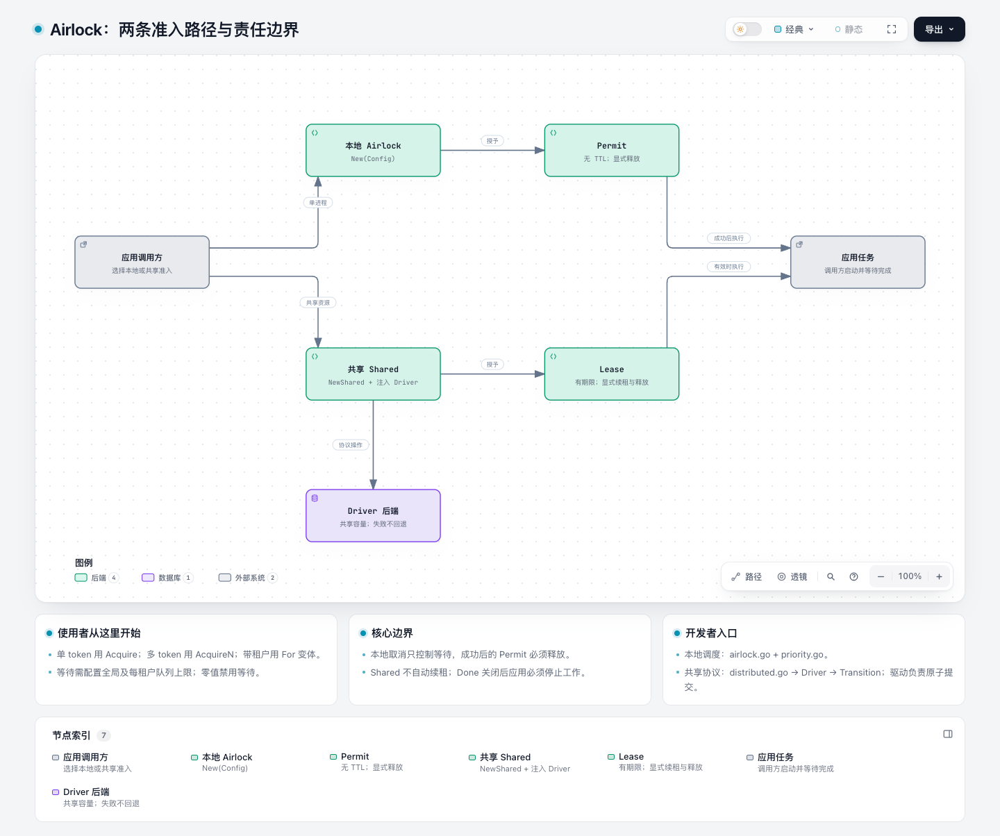
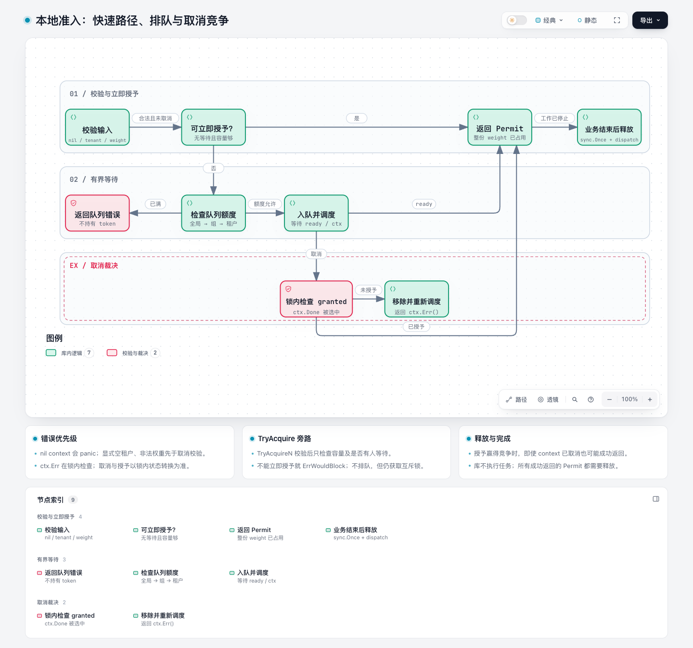
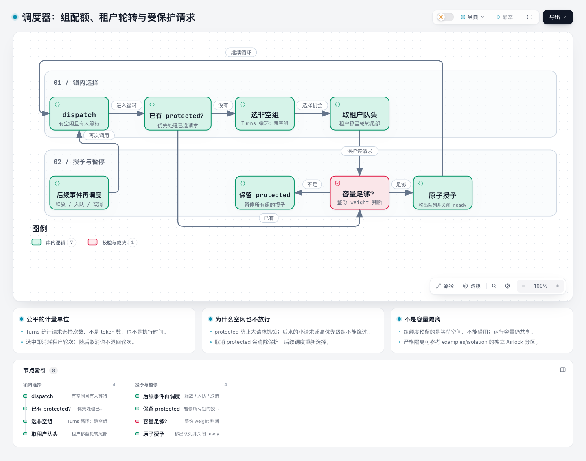
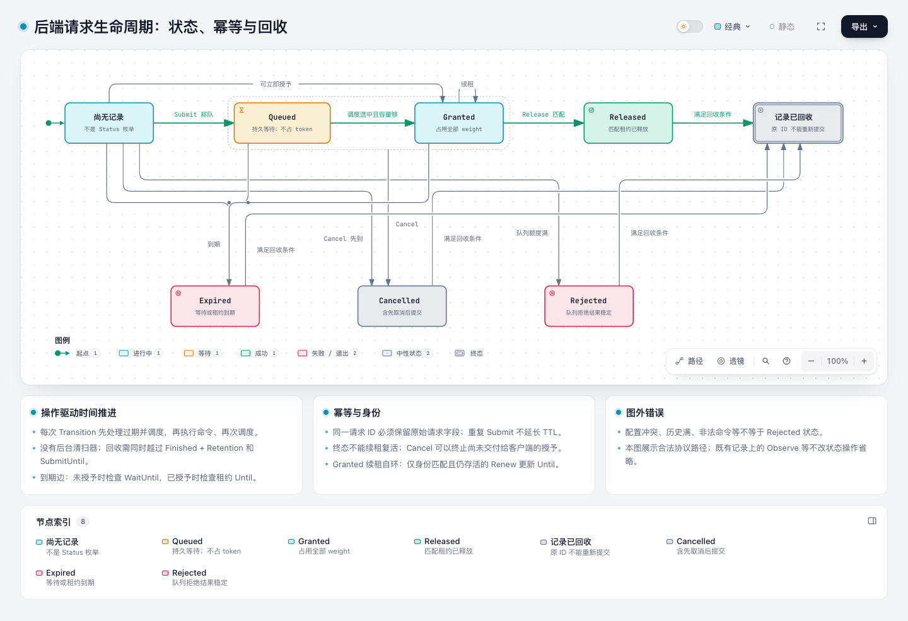
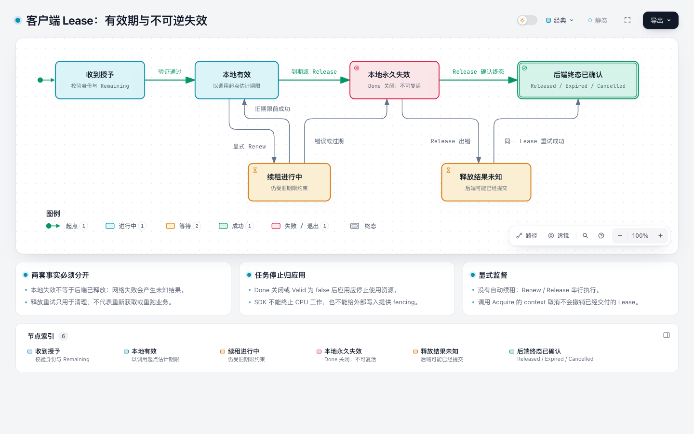
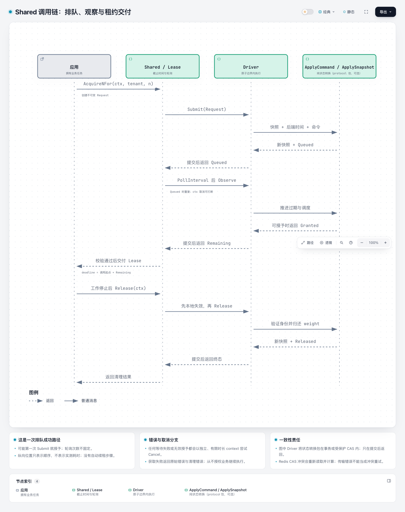
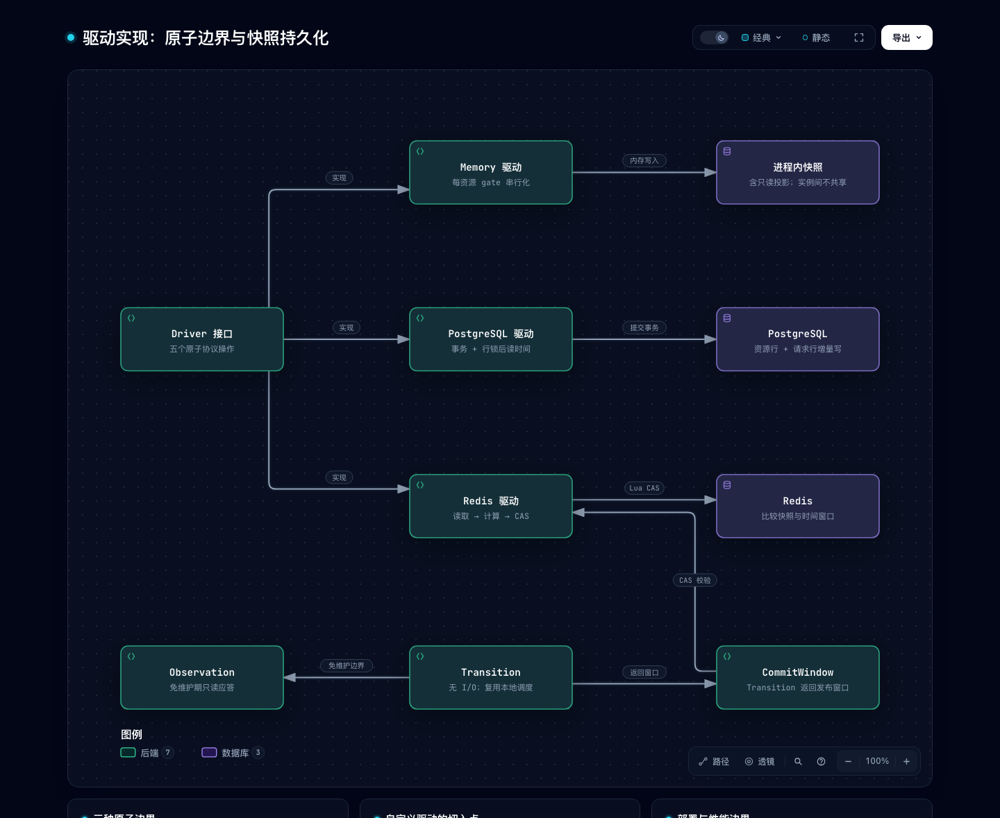
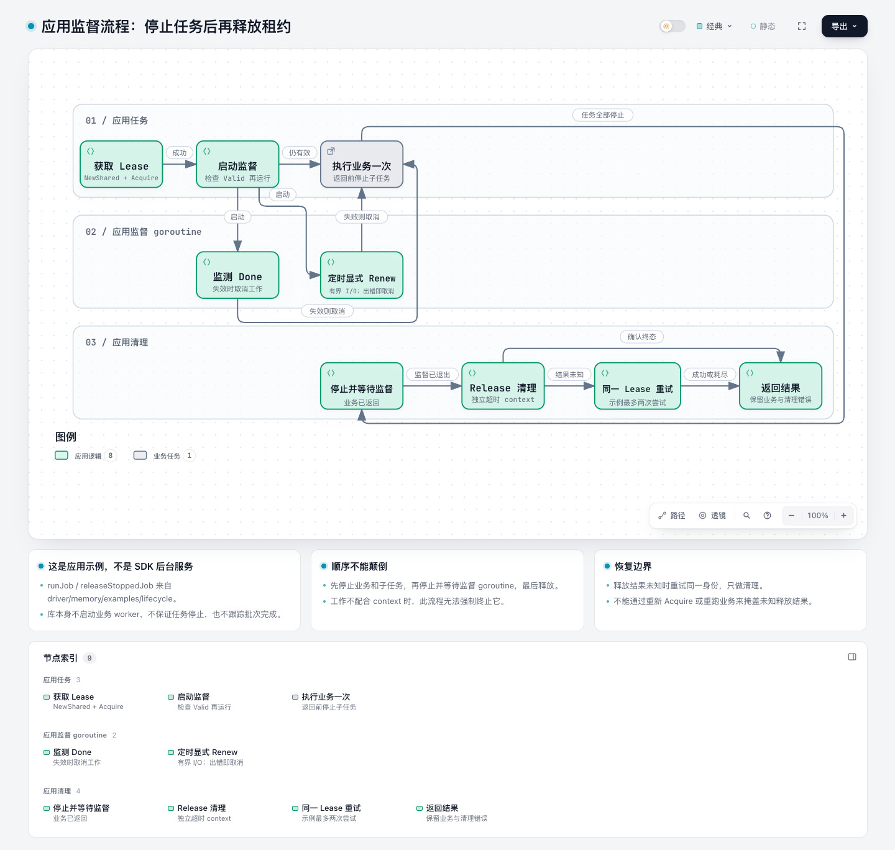

# Airlock 架构图集

[English](README.md) | [简体中文](README.zh-CN.md) | [打开图集导航](index.html)

这套图解释已实现的准入机制，并把读者引向可运行示例、源码与回归测试。
图中文字以中文为主，API 名称保留英文；英文导读覆盖同样的入口与边界。

## 怎么看

- **使用者**：01 整体架构 → 02 本地准入；使用共享容量时继续 05 租约 → 08 应用监督。
- **初学者**：01 → 02 → 03，先理解容量、等待请求、租户和 permit 的区别；再看 04–06 的分布式协议。
- **开发者**：03 调度 → 04 状态机 → 07 驱动；按下方需求表找到实现和测试。

GitHub 文件页不会执行 HTML。下方 PNG 可直接预览；克隆仓库后，用浏览器打开
`docs/architecture/index.html`，或下载单张 HTML 后打开。HTML 内联了图和查看器，
无需服务端；支持搜索、节点聚焦、浅深主题及 PNG/SVG 导出。
PNG 是静态浏览器预览，不替代可探索的 HTML。源码引用固定到
[`beb9c6f`](https://github.com/tr1v3r/airlock/tree/beb9c6fcd49f9d270bfb5f951ac0b400b5aeca0d)。
图集 PR 基于随后合入 SDK 注释的 `045c387`；图中的源码行号属于固定快照，不是浮动的 `dev`。

## 按需求切入

| 需求 | 使用入口 / 修改位置 | 验证重点 |
| --- | --- | --- |
| 限制单进程在途工作 | [hello](../../examples/hello/example.go)、`New(Config)` | 成功后释放；队列零值不等待 |
| 批量原子占用容量 | [weighted](../../examples/weighted/example.go)、`AcquireNFor` | 不部分授予；大请求保护 |
| 忙时立即拒绝 | [tryacquire](../../examples/tryacquire/example.go)、`TryAcquireNFor` | 不插队；仍获取 mutex |
| 租户优先级与等待预算 | [priority](../../examples/priority/example.go)、[priority.go](../../priority.go) | 按请求选择计量；不保证 token 份额 |
| 高低优先级容量隔离 | [isolation](../../examples/isolation/example.go) | 独立实例、固定分区；不是借用或抢占 |
| 多实例共享容量 | [Shared 使用指南](../guides/shared.zh-CN.md)、`NewShared` | 资源配置一致；租约不等于强制停止 |
| 管理续租与任务停止 | [lifecycle 示例](../../driver/memory/examples/lifecycle/main.go) | 先停止任务及监督，再释放；未知结果只重试清理 |
| 新增后端 | [自定义驱动指南](../guides/drivers.zh-CN.md)、[Driver](../../driver.go) | 后端时间、原子提交、幂等、未知结果；运行 conformance |
| 修改调度 / 状态机 | [airlock.go](../../airlock.go)、[driver_state.go](../../driver_state.go) | 本地与共享复用调度；同时检查 model / race 测试 |

## 图集

### 01 · Airlock：两条准入路径与责任边界

从 New 还是 NewShared 开始？谁执行任务？

[HTML](.archify/architecture-overview-20261024-152114/overview.html) · [JSON](.archify/architecture-overview-20261024-152114/candidate.json)

实现：[airlock.go](../../airlock.go), [distributed.go](../../distributed.go), [driver.go](../../driver.go)

测试：[airlock_contract_test.go](../../airlock_contract_test.go), [shared_options_test.go](../../shared_options_test.go)

### 02 · 本地准入：快速路径、排队与取消竞争

为什么申请失败？取消与授予同时发生怎么办？

[HTML](.archify/workflow-local-admission-20261024-152114/local-admission.html) · [JSON](.archify/workflow-local-admission-20261024-152114/candidate.json)

实现：[airlock.go](../../airlock.go), [try_acquire.go](../../try_acquire.go)

测试：[weighted_test.go](../../weighted_test.go), [try_acquire_test.go](../../try_acquire_test.go)

### 03 · 调度器：组配额、租户轮转与受保护请求

为什么还有空闲 token 却不能放行？

[HTML](.archify/workflow-scheduler-20261024-152114/scheduler.html) · [JSON](.archify/workflow-scheduler-20261024-152114/candidate.json)

实现：[priority.go](../../priority.go), [airlock.go](../../airlock.go), [examples/isolation/example.go](../../examples/isolation/example.go)

测试：[priority_test.go](../../priority_test.go), [local_model_test.go](../../local_model_test.go)

### 04 · 后端请求生命周期：状态、幂等与回收

哪些状态能续租、取消和回收？

[HTML](.archify/lifecycle-request-states-20261024-152114/request-states.html) · [JSON](.archify/lifecycle-request-states-20261024-152114/candidate.json)

实现：[driver_state.go](../../driver_state.go), [driver.go](../../driver.go)

测试：[driver_state_test.go](../../driver_state_test.go), [driver_model_test.go](../../driver_model_test.go)

### 05 · 客户端 Lease：有效期与不可逆失效

本地失效是否代表后端已经释放？

[HTML](.archify/lifecycle-lease-states-20261024-152114/lease-states.html) · [JSON](.archify/lifecycle-lease-states-20261024-152114/candidate.json)

实现：[distributed.go](../../distributed.go)

测试：[distributed_concurrency_test.go](../../distributed_concurrency_test.go), [distributed_clock_test.go](../../distributed_clock_test.go)

### 06 · Shared 调用链：排队、观察与租约交付

排队后是谁推进状态？何时才能运行任务？

[HTML](.archify/sequence-shared-sequence-20261024-152114/shared-sequence.html) · [JSON](.archify/sequence-shared-sequence-20261024-152114/candidate.json)

实现：[distributed.go](../../distributed.go), [driver/postgres/postgres.go](../../driver/postgres/postgres.go), [driver/redis/redis.go](../../driver/redis/redis.go)

测试：[distributed_test.go](../../distributed_test.go), [distributed_concurrency_test.go](../../distributed_concurrency_test.go)

### 07 · 驱动实现：原子边界与快照持久化

自定义驱动必须在哪里保证原子性？

[HTML](.archify/architecture-driver-boundaries-20261024-152114/driver-boundaries.html) · [JSON](.archify/architecture-driver-boundaries-20261024-152114/candidate.json)

实现：[driver.go](../../driver.go), [driver_transition.go](../../driver_transition.go), [driver/postgres/postgres.go](../../driver/postgres/postgres.go), [driver/redis/scripts.go](../../driver/redis/scripts.go)

测试：[internal/driverconformance/conformance.go](../../internal/driverconformance/conformance.go), [driver/redis/window_test.go](../../driver/redis/window_test.go)

### 08 · 应用监督流程：停止任务后再释放租约

任务、续租和释放应该按什么顺序停止？

[HTML](.archify/workflow-application-lifecycle-20261024-152114/application-lifecycle.html) · [JSON](.archify/workflow-application-lifecycle-20261024-152114/candidate.json)

实现：[driver/memory/examples/lifecycle/main.go](../../driver/memory/examples/lifecycle/main.go)

测试：[driver/memory/examples/lifecycle/main_test.go](../../driver/memory/examples/lifecycle/main_test.go)

## 阅读边界

- 图展示代码行为，不代表测得的吞吐或 SLA；时序图的纵轴只表示顺序。
- 后端状态图保留完整状态转换，交叉线较多；可在 HTML 中聚焦状态逐条阅读。常见的重复观察、自循环等无状态变化操作省略。
- 客户端 Lease 图单独描述本地有效性。失效不等于后端已释放，终态也无法强制结束应用工作。
- 驱动图展示 I/O 所有权；Memory / PostgreSQL 调用 Transition 的关系写在图下卡片中。Redis 使用其乐观包装器。
- 应用监督图来自可运行示例；`runJob` 不是 SDK API。获取失败不启动业务，监督取消与业务完成的先后取决于实际执行。
- 提案、尚未合入的 PostgreSQL relational 分支、部署拓扑和性能瀑布图未被当作已实现架构。

## 维护与验证

编辑 `manifest.json` 指向的 `candidate.json`，保留与对应源码版本一致的引用。
复现和发布前检查见 [维护说明](MAINTAINING.md)。[验证清单](verification.json) 记录 HTML 与输入哈希和自动化结果。
